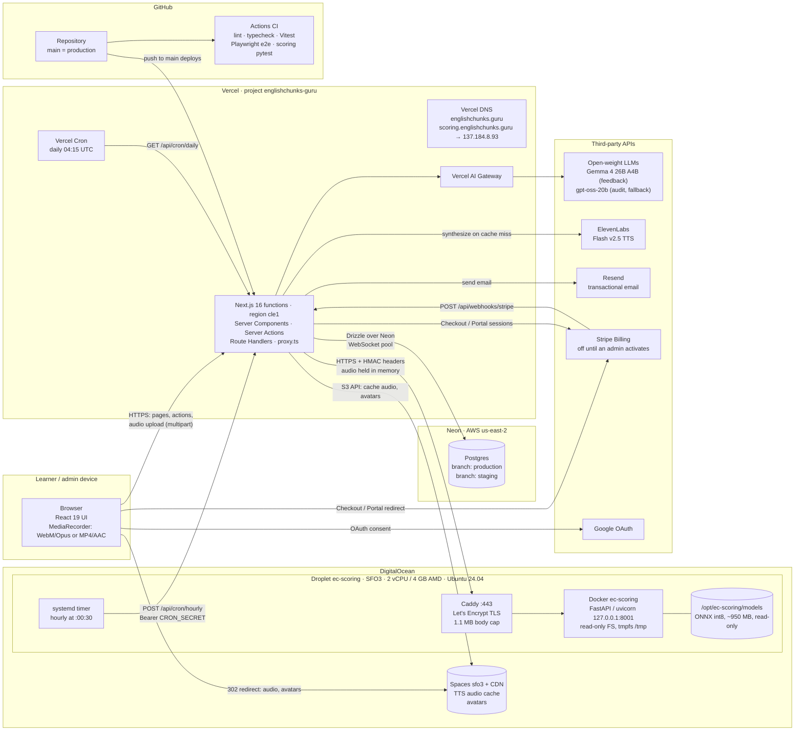
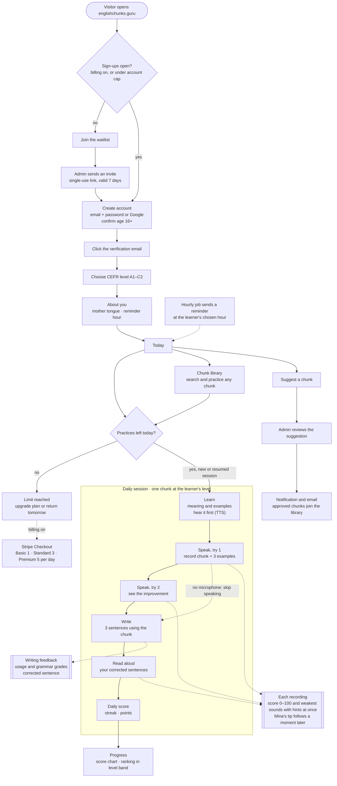

# Architecture

Three views of EnglishChunks.guru, read from the code: where it runs, how the code is layered, and the path a learner takes from the landing page to a daily score. GitHub renders the Mermaid diagrams below.

- [1. Physical architecture](#1-physical-architecture)
- [2. Logical architecture (components)](#2-logical-architecture-components)
- [3. User workflow](#3-user-workflow)

## 1. Physical architecture

Production hosts, managed services and the network calls between them. The web app is serverless on Vercel; speech scoring runs on one self-managed Droplet so recordings never reach a third party.

- **Web tier.** One Next.js app on Vercel serves the marketing site, learner app, admin console and every API route. Functions run in `cle1`, next to the Neon database in us-east-2. Previews sit behind Vercel Authentication.
- **Scoring tier.** The Droplet runs Caddy in front of a read-only Docker container ([`scoring/deploy`](../scoring/deploy/)). Uploads stay in memory: Caddy caps bodies at 1.1 MB, Starlette never spools to disk, and `/tmp` is a 64 MB tmpfs.
- **Scheduled jobs.** Vercel Hobby cron only runs daily, so the daily billing sweep uses Vercel Cron ([`web/vercel.json`](../web/vercel.json)) and the hourly job (reminder emails, invite expiry) is triggered by a systemd timer on the Droplet.
- **Data stores.** Postgres holds all application state. Spaces holds generated speech and avatars, served through its CDN. Learner recordings are never stored anywhere.

## 2. Logical architecture (components)

How the code is organised. Requests flow down through access checks into thin Server Actions and Route Handlers, which call domain modules; domain modules reach the outside world only through swappable provider adapters.

```mermaid
flowchart TB
  subgraph UI["Presentation · web/src/app + components"]
    direction LR
    MK["(marketing)<br/>landing · plans<br/>privacy · terms"]
    AUP["(auth)<br/>sign-up · sign-in · verify-email<br/>forgot / reset · waitlist"]
    ONB["onboarding<br/>level · about"]
    LRN["(learner)<br/>today · practice/:id · library<br/>progress · profile · billing<br/>submit-chunk · my-submissions"]
    ADM["admin<br/>dashboard · users · chunks<br/>submissions · waitlist · settings"]
  end

  subgraph GATE["Access control"]
    direction LR
    PX["proxy.ts<br/>non-admins get 404 on /admin"]
    AZ["authz · page-guards · admin-guard<br/>rate-limit · cron-auth"]
  end

  subgraph ENTRY["Entry points"]
    direction LR
    SA["Server Actions · server/actions<br/>session · library · profile · submissions<br/>waitlist · auth · unsubscribe<br/>admin · admin-settings"]
    RH["Route Handlers · app/api<br/>auth/[...all] · sessions/:id/attempts (NDJSON)<br/>tts · billing/checkout · billing/portal<br/>webhooks/stripe · cron/daily · cron/hourly<br/>profile/avatar · unsubscribe"]
  end

  subgraph DOM["Domain · web/src/lib/domain"]
    direction LR
    D1["Practice<br/>session-engine · chunk-picker<br/>limits · caps · attempts<br/>writing · daily-score"]
    D2["Feedback<br/>feedback · prompts<br/>feedback-guards<br/>curated sound hints"]
    D3["Engagement<br/>points · ranking · progress<br/>notifications · reminders"]
    D4["Content<br/>library · library-seeding<br/>submissions · submission-review<br/>dedupe · normalize · tts-service"]
    D5["Accounts and billing<br/>signup-gate · profile · avatar<br/>account-deletion · subscription<br/>billing-state · stripe-webhook"]
    D6["Admin and ops<br/>admin-users · admin-chunks<br/>admin-dashboard · audit · usage"]
  end

  subgraph PRV["Providers · lib/providers + lib/auth (swappable adapters)"]
    direction LR
    P1["auth<br/>Better Auth<br/>admin + username plugins"]
    P2["scoring-client<br/>HMAC-signed, 20 s timeout"]
    P3["llm<br/>AI SDK via gateway<br/>5 s then fallback model"]
    P4["tts<br/>ElevenLabs"]
    P5["storage<br/>S3 / Spaces"]
    P6["email<br/>Resend + React Email"]
    P7["billing<br/>Stripe"]
  end

  subgraph DATA["Persistence · web/src/db (Drizzle, 7 migrations)"]
    direction LR
    T1[("Identity<br/>user · session · account<br/>verification · rate_limit")]
    T2[("Content<br/>chunk · chunk_example<br/>sound_hint · audio_clip · voice")]
    T3[("Practice<br/>practice_session · attempt<br/>writing_result")]
    T4[("Engagement<br/>points_ledger · notification<br/>chunk_submission")]
    T5[("Billing and ops<br/>subscription · stripe_event<br/>waitlist_entry · app_setting<br/>usage_counter · action_counter<br/>admin_audit_log")]
  end

  subgraph SCR["Scoring service · scoring/src/scoring (Python 3.12)"]
    direction LR
    S1["app.py<br/>POST /v1/score<br/>POST /v1/phonemize<br/>GET /healthz<br/>HMAC check, size limits"] --> S2["pipeline.py<br/>orchestrates, times stages"]
    S2 --> S3["audio.py<br/>decode in memory<br/>to 16 kHz mono"]
    S3 --> S4["engines.py<br/>Silero VAD trim<br/>Parakeet TDT ASR<br/>wav2vec2 phoneme CTC"]
    S4 --> S5["align.py<br/>word and phoneme<br/>alignment, GOP"]
    S5 --> S6["combine.py<br/>0–100 score from<br/>sounds · words · flow"]
    S6 --> S7["hint_map.py<br/>weakest sounds"]
  end

  UI --> GATE --> ENTRY --> DOM --> PRV
  DOM --> DATA
  P1 --> DATA
  P2 -. "HTTPS" .-> S1
```

- **Attempt request.** `/api/sessions/:id/attempts` checks the step and per-session cap, sends audio to the scorer, stores the score, then streams it to the browser as NDJSON before the LLM tip arrives as a second line.
- **Deterministic teaching.** Weakest sounds map to a curated table of about 40 IPA hints stored in `sound_hint`. The LLM coach, Mina, only phrases the tip around those hints, with a fallback tip if the model is slow.
- **Content pipeline.** `library-seeding` drafts chunks with the feedback model, gets IPA from `/v1/phonemize`, and has an independent auditor model check them. Failed audits wait in the admin queue.
- **Limits.** A daily practice limit (by plan tier, trial, early tester or admin) is reserved under a row lock when a session starts. Daily and library sessions share it.

## 3. User workflow

The learner journey from first visit to a daily score, with the side paths for the library, chunk suggestions and the admin actions that feed back into it.

- **Getting in.** Until billing is switched on, an admin-set account cap limits sign-ups; people beyond it join the waitlist. Password accounts must verify their email before practising.
- **Resuming.** Today redirects to an unfinished daily session if one exists, so a learner never starts two daily sessions in one local day. Scoring outages don't use up the day's practice.
- **Billing.** Once an admin activates billing, new learners get a 7-day trial on the Basic limit with no card. Stripe webhooks keep the `subscription` table in sync.
- **Admin loop.** Admins review audit-failed and learner-suggested chunks, invite people from the waitlist, manage users, and set the account cap and billing switch.
