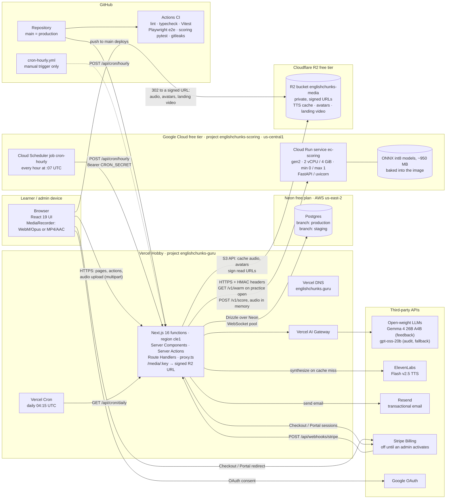
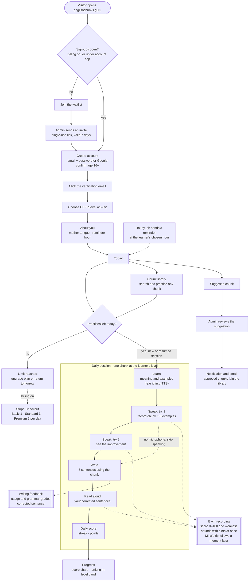

# Architecture

Views of EnglishChunks.guru, read from the code: where it runs, how the code is layered, the path a learner takes from the landing page to a daily score, and how the hosting got to where it is. GitHub renders the Mermaid diagrams below. The reasons behind each choice are in [`rationals.md`](./rationals.md).

- [1. Physical architecture](#1-physical-architecture)
- [2. Logical architecture (components)](#2-logical-architecture-components)
- [3. User workflow](#3-user-workflow)
- [4. Hosting evolution](#4-hosting-evolution)

## 1. Physical architecture

Production hosts, managed services and the network calls between them, as of 2026-11-21. Every host runs on a free tier: the web app is serverless on Vercel, speech scoring is the project's own scale-to-zero container on Google Cloud Run (so recordings never reach a third-party API), and files live in a private Cloudflare R2 bucket. Paid usage is limited to per-call APIs (LLMs, text-to-speech, email).

- **Web tier.** One Next.js app on Vercel serves the marketing site, learner app, admin console and every API route. Functions run in `cle1`, next to the Neon database in us-east-2. Previews sit behind Vercel Authentication.
- **Scoring tier.** Cloud Run runs the container from [`scoring/deploy/Dockerfile.cloudrun`](../scoring/deploy/Dockerfile.cloudrun) and scales to zero between sessions, staying inside the free tier. Opening a practice page sends a signed `GET /v1/warm` so the ~15 s cold start finishes before the first recording; the web client waits up to 30 s as a backstop. Uploads stay in memory and request logs hold only metadata. Setup: [`scoring/deploy/RUNBOOK.md`](../scoring/deploy/RUNBOOK.md) §2C.
- **Scheduled jobs.** Vercel Hobby cron only runs daily, so the daily billing sweep uses Vercel Cron ([`web/vercel.json`](../web/vercel.json)) and the hourly job (reminder emails, invite expiry) is triggered by a Cloud Scheduler job (`cron-hourly`, free tier). GitHub's scheduled workflows ran only a few times a day, so [`.github/workflows/cron-hourly.yml`](../.github/workflows/cron-hourly.yml) is now a manual trigger.
- **Data stores.** Postgres holds all application state. A private R2 bucket holds generated speech, avatars and the landing video; browsers get signed URLs (directly for audio, via the `/media/<key>` redirect for avatars and video). Learner recordings are never stored anywhere.

## 2. Logical architecture (components)

How the code is organised. Requests flow down through access checks into thin Server Actions and Route Handlers, which call domain modules; domain modules reach the outside world only through swappable provider adapters.

```mermaid
flowchart TB
  subgraph UI["Presentation · web/src/app + components"]
    direction LR
    MK["(marketing)<br/>landing · plans<br/>privacy · terms"]
    AUP["(auth)<br/>sign-up · sign-in · verify-email<br/>forgot / reset · waitlist"]
    ONB["onboarding<br/>level · about"]
    LRN["(learner)<br/>today · practice/:id · library<br/>progress · profile · billing<br/>submit-chunk · my-submissions"]
    ADM["admin<br/>dashboard · users · chunks<br/>submissions · waitlist · settings"]
  end

  subgraph GATE["Access control"]
    direction LR
    PX["proxy.ts<br/>non-admins get 404 on /admin"]
    AZ["authz · page-guards · admin-guard<br/>rate-limit · cron-auth"]
  end

  subgraph ENTRY["Entry points"]
    direction LR
    SA["Server Actions · server/actions<br/>session · library · profile · submissions<br/>waitlist · auth · unsubscribe<br/>admin · admin-settings"]
    RH["Route Handlers · app/api<br/>auth/[...all] · sessions/:id/attempts (NDJSON)<br/>tts · billing/checkout · billing/portal<br/>webhooks/stripe · cron/daily · cron/hourly<br/>profile/avatar · unsubscribe · media/[...key]"]
  end

  subgraph DOM["Domain · web/src/lib/domain"]
    direction LR
    D1["Practice<br/>session-engine · chunk-picker<br/>limits · caps · attempts<br/>writing · daily-score"]
    D2["Feedback<br/>feedback · prompts<br/>feedback-guards<br/>curated sound hints"]
    D3["Engagement<br/>points · ranking · progress<br/>notifications · reminders"]
    D4["Content<br/>library · library-seeding<br/>submissions · submission-review<br/>dedupe · normalize · tts-service"]
    D5["Accounts and billing<br/>signup-gate · profile · avatar<br/>account-deletion · subscription<br/>billing-state · stripe-webhook"]
    D6["Admin and ops<br/>admin-users · admin-chunks<br/>admin-dashboard · audit · usage"]
  end

  subgraph PRV["Providers · lib/providers + lib/auth (swappable adapters)"]
    direction LR
    P1["auth<br/>Better Auth<br/>admin + username plugins"]
    P2["scoring-client<br/>HMAC-signed, 30 s timeout<br/>warm() on practice open"]
    P3["llm<br/>AI SDK via gateway<br/>5 s then fallback model"]
    P4["tts<br/>ElevenLabs"]
    P5["storage<br/>S3 API / R2<br/>private, signed URLs"]
    P6["email<br/>Resend + React Email"]
    P7["billing<br/>Stripe"]
  end

  subgraph DATA["Persistence · web/src/db (Drizzle, 9 migrations)"]
    direction LR
    T1[("Identity<br/>user · session · account<br/>verification · rate_limit")]
    T2[("Content<br/>chunk · chunk_example<br/>sound_hint · audio_clip · voice")]
    T3[("Practice<br/>practice_session · attempt<br/>writing_result")]
    T4[("Engagement<br/>points_ledger · notification<br/>chunk_submission")]
    T5[("Billing and ops<br/>subscription · stripe_event<br/>waitlist_entry · app_setting<br/>usage_counter · action_counter<br/>admin_audit_log")]
  end

  subgraph SCR["Scoring service · scoring/src/scoring (Python 3.12)"]
    direction LR
    S1["app.py<br/>POST /v1/score<br/>POST /v1/phonemize<br/>GET /v1/warm · GET /healthz<br/>HMAC check, size limits"] --> S2["pipeline.py<br/>orchestrates, times stages"]
    S2 --> S3["audio.py<br/>decode in memory<br/>to 16 kHz mono"]
    S3 --> S4["engines.py<br/>Silero VAD trim<br/>Parakeet TDT ASR<br/>wav2vec2 phoneme CTC"]
    S4 --> S5["align.py<br/>word and phoneme<br/>alignment, GOP"]
    S5 --> S6["combine.py<br/>0–100 score from<br/>sounds · words · flow"]
    S6 --> S7["hint_map.py<br/>weakest sounds"]
  end

  UI --> GATE --> ENTRY --> DOM --> PRV
  DOM --> DATA
  P1 --> DATA
  P2 -. "HTTPS" .-> S1
```

- **Attempt request.** `/api/sessions/:id/attempts` checks the step and per-session cap, sends audio to the scorer, stores the score, then streams it to the browser as NDJSON before the LLM tip arrives as a second line.
- **Deterministic teaching.** Weakest sounds map to a curated table of about 40 IPA hints stored in `sound_hint`. The LLM coach, Mina, only phrases the tip around those hints, with a fallback tip if the model is slow.
- **Content pipeline.** `library-seeding` drafts chunks with the feedback model, gets IPA from `/v1/phonemize`, and has an independent auditor model check them. Failed audits wait in the admin queue.
- **Limits.** A daily practice limit (by plan tier, trial, early tester or admin) is reserved under a row lock when a session starts. Daily and library sessions share it.

## 3. User workflow

The learner journey from first visit to a daily score, with the side paths for the library, chunk suggestions and the admin actions that feed back into it.

- **Getting in.** Until billing is switched on, an admin-set account cap limits sign-ups; people beyond it join the waitlist. Password accounts must verify their email before practising.
- **Resuming.** Today redirects to an unfinished daily session if one exists, so a learner never starts two daily sessions in one local day. Scoring outages don't use up the day's practice.
- **Billing.** Once an admin activates billing, new learners get a 7-day trial on the Basic limit with no card. Stripe webhooks keep the `subscription` table in sync.
- **Admin loop.** Admins review audit-failed and learner-suggested chunks, invite people from the waitlist, manage users, and set the account cap and billing switch.

## 4. Hosting evolution

The product and code stayed the same while the hosting moved, step by step, from about $33/month of fixed servers to free tiers. Each move was measured before switching and kept the old host as a fallback until production had run cleanly.

```mermaid
flowchart LR
  subgraph A["2026-10-16 · launch · ~$33/month fixed"]
    direction TB
    A1["Vercel Hobby<br/>web"]
    A2["DigitalOcean Droplet<br/>2 vCPU / 4 GB AMD · $28<br/>scoring + hourly systemd timer"]
    A3["DigitalOcean Spaces + CDN · $5<br/>TTS cache · avatars · video"]
    A4["Neon free<br/>Postgres"]
  end

  subgraph B["2026-11-16 · scoring on Cloud Run · Droplet idle as fallback"]
    direction TB
    B2["Cloud Run · scale-to-zero<br/>calibration 88.8 % vs 89.1 %"]
    B3["GitHub Actions schedule<br/>hourly cron (proved too sparse)"]
    B4["Droplet kept one week<br/>for rollback"]
  end

  subgraph C["2026-11-21 · all free tiers · $0 fixed"]
    direction TB
    C1["Droplet deleted"]
    C2["Cloud Scheduler<br/>hourly cron on time"]
    C3["Cloudflare R2<br/>private bucket, signed URLs"]
  end

  A --> B --> C
```

| Concern | Launch (2026-10-16) | Now (2026-11-21) | Monthly fixed cost |
|---|---|---|---|
| Web app | Vercel Hobby | Vercel Hobby | $0 → $0 |
| Database | Neon free | Neon free | $0 → $0 |
| Speech scoring | DigitalOcean Droplet `s-2vcpu-4gb-amd` | Google Cloud Run, gen2, min 0 / max 1 | $28 → $0 |
| Hourly job (reminders, invite expiry) | systemd timer on the Droplet | Google Cloud Scheduler | (in Droplet) → $0 |
| Files (TTS cache, avatars, video) | DigitalOcean Spaces + CDN | Cloudflare R2, private | $5 → $0 |
| **Total fixed** | | | **~$33 → $0** |

Usage-based costs are unchanged: LLM calls through Vercel AI Gateway, ElevenLabs text-to-speech (generated lazily and cached), and Resend email.
